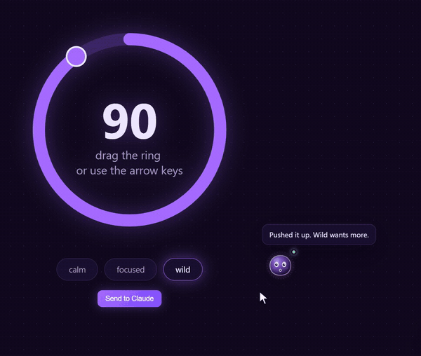

<p align="center"></p>

<p align="center">
  <a href="https://github.com/offensiveadhd/lets-unique-template/actions/workflows/validate.yml"></a>
  
  
  <a href="LICENSE"></a>
</p>

<p align="center"><b>Build your own unique.</b><br>A minimal but complete <b>unique</b> for <a href="https://github.com/offensiveadhd/lets">lets</a>: a full-screen dark-violet mood dial. The human drags a ring (or uses the arrow keys) to set a value 0–100 and picks one of three mode chips (calm / focused / wild); Doto, the companion, reacts and Claude can move the dial itself. It demonstrates the entire unique contract in a handful of files you can rename and build on: manifest, guide, static UI, LIP events and commands, and the session block (handoff and resume).</p>

<p align="center">
  <a href="#see-it-run">See it run</a> ·
  <a href="#use-this-template">Use this template</a> ·
  <a href="#local-development">Local development</a> ·
  <a href="#try-the-handoff">Try the handoff</a> ·
  <a href="#file-layout">File layout</a> ·
  <a href="#how-the-ui-talks-lip">How the UI talks LIP</a> ·
  <a href="#the-session-block">The session block</a> ·
  <a href="#versions">Versions</a> ·
  <a href="#publishing">Publishing</a> ·
  <a href="#the-rules">The rules</a>
</p>

The unique in this repository is named `pulse`. The GIFs on this page show pulse
itself: they are yours to delete when you start your own unique.

## See it run

<p align="center">
  <a href="assets/demo.mp4"></a>
</p>

One real take of the pulse window on a real lets host, recorded in a headless
browser. The hand is real input: a drag along the ring, two presses of the Up
arrow, a click on the chip and a click on **Send to Claude**. Claude's side is
sent through the engine's own tools by a script written ahead, and it is what
[`GUIDE.md`](GUIDE.md) tells Claude to send: a glow on the ring and one line in
Doto's voice for each settled value, a mood for the mode, then the dial itself
with the reason in the same call. Select the picture for the
[full take](assets/demo.mp4), which goes on to the resume. How it was recorded
is in [lets/promo](https://github.com/offensiveadhd/lets/tree/main/promo).

<details>
<summary>The same take as LIP messages</summary>

| In the take | Up, from the window | Down, from Claude |
|---|---|---|
| The drag down to 20 | `pulse.value {value: 20}`, once, when the drag settles (the debounce is 200 ms) | In one call: `pulse.glow {color: "#a66bff"}` and `entity.say`: "Running on fumes. Wrap it up?" |
| Two presses of the Up arrow | `pulse.value {value: 25}`, then `pulse.value {value: 30}` | For the settled one, in one call: `pulse.glow {color: "#a66bff"}` and `entity.say`: "Picking up. Keep going." |
| The chip | `pulse.mode {mode: "wild"}` | `entity.mood {mood: "alert"}`. Then, in one call: `pulse.glow {color: "#ff6bd6", ttl: 1500}`, `pulse.set {value: 90}` and `entity.say`: "Pushed it up. Wild wants more." |
| The dial lands on 90 | `pulse.value {value: 90}`: a `pulse.set` comes back as a value event | nothing: Claude said why in the call that moved it |
| **Send to Claude** | `pulse.export {label: "wild · 90", value: 90, mode: "wild"}` | the engine saves the session and tells the window to close; Claude answers in the Claude Code chat, which the take does not show |
| The resume (full take) | nothing: a restore is silent | `open {unique: "pulse", resume: "last"}`. The engine queues `pulse.load` with the saved payload; then `entity.say`: "Back to wild. Where were we?" |

</details>

## Use this template

This is a GitHub **template repo**. From it to your own unique:

1. Press **Use this template** and name the new repository
   `lets-unique-<name>`.
2. Clone it.
3. Rename `pulse` everywhere: the manifest's `name`, `domains` and `session`,
   the event and command types, `data-unique`, `Lets.connect`, `package.json`
   and the GUIDE.
4. Build: put your own UI where the dial is, and your own pictures in
   `assets/` (or delete them).

Run `npm run validate` after the rename: it fails on an event or command whose
domain the manifest does not declare.

<details>
<summary>Where <code>pulse</code> appears, file by file</summary>

| File | What to change |
|---|---|
| `unique.json` | `name`, `domains`, the three types in `session`, every key under `events` and `commands`. Also `title`, `description` and `tags`, and the `your-name` placeholders in `author` and `repository`. |
| `ui/index.html` | `<body data-unique="pulse">` and the `<title>`. |
| `ui/app.js` | `unique: 'pulse'` in `Lets.connect(…)`, and every `pulse.*` type in `lets.emit`, `lets.emitNow` and `lets.on`. |
| `ui/style.css` | the `body[data-unique="pulse"]` selector. |
| `GUIDE.md` | every `pulse.*` event and command, and what Claude does with each. |
| `package.json` | `name`, `description` and `repository`. |
| `README.md`, `CHANGELOG.md`, `icon.svg`, `assets/` | yours to rewrite, redraw, replace or delete. |

</details>

## Local development

Uniques are served by the lets host, never opened from disk. Put this
folder where the host looks for uniques (a real folder: the host does not
follow symlinks or junctions):

- project-local: `<project>/.lets/uniques/pulse`
- or global: `~/.lets/uniques/pulse`
- or anywhere, by pointing `LETS_UNIQUES_DIRS` at the folder that contains
  this one (several folders are separated by `;` on Windows, `:` elsewhere)

then run the host standalone from your checkout of the lets repo (`<lets>`
below is that checkout):

```bash
node <lets>/engine/bin/lets.mjs serve --open pulse --verbose
```

It starts the loopback server, serves the SDK at `/sdk/…`, your folder at
`/u/pulse/…`, opens the window, and with `--verbose` prints every event your UI
emits. Console errors = something is wrong; the quality bar is zero console
errors in Chromium/Edge.

Validate before every push:

```bash
npm run validate                              # scripts/validate.mjs, no install needed
node <lets>/engine/bin/lets.mjs validate .    # the host's own check
```

`npm run validate` checks `unique.json` against the vendored manifest schema,
that `entry`, `guide` and `icon` exist, that no reserved domain is used, and
that `GUIDE.md` is not too long. The GitHub Actions workflow runs it on every
push and pull request, together with `node --check` on `ui/*.js`.

## Try the handoff

<p align="center">
  
</p>

The template shows "Send to Claude" the way the engine expects it:

1. Set the dial, pick a mode, press **Send to Claude**. The UI emits
   `pulse.export {label, value, mode}`.
2. The engine saves it as a session, the window says goodbye and closes, and
   Claude answers in the Claude Code chat (see `GUIDE.md`).
3. `/lets pulse resume` reopens the window; the engine queues `pulse.load` with
   the saved payload and the dial comes back as you sent it.

If Claude is not listening, the UI says so ("Doto is away…") and Claude reads
the export with your next message.

A user who set `"handoff": "stay"` keeps the window open: the export then
arrives with `handoff: false`, and Claude answers in the window with one
`entity.say` instead (see `GUIDE.md`).

## File layout

What every file is for:

```text
unique.json        the manifest: name, version, entry, engine, domains,
                   events, commands, permissions, session, tags.
                   Schema-validated by the host BEFORE the unique is
                   served. This is the contract.
GUIDE.md           prose for Claude: what each event means and how to
                   react, what commands exist, handoff etiquette. The
                   `open` tool returns it. Keep it under ~1,200 words.
icon.svg           64×64 violet ring shown in listings.
assets/            what this README shows: the banner, the diagram, the
                   GIFs and the full take. They show pulse: replace them
                   with your own, or delete them.
ui/index.html      the entry page; <body data-unique="pulse">.
ui/app.js          the unique logic: ring drag and keyboard, chips,
                   Send to Claude, LIP wiring.
ui/style.css       deep-violet theme; re-declares the --lets-* variables
                   so it survives a missing shell CSS.
package.json       npm metadata and the `validate` script. No dependencies.
scripts/validate.mjs
                   zero-dependency manifest check; what `npm run validate`
                   and CI run.
schemas/unique.schema.json
                   the LIP manifest schema, vendored from the lets repo
                   (protocol/schemas/) so validation works offline.
.github/workflows/validate.yml
                   CI: validate the manifest, syntax-check the UI.
CHANGELOG.md       what changed in each version.
LICENSE            MIT.
```

Nothing in `assets/` is part of the unique: the manifest names `entry`,
`guide` and `icon`, and none of them points there.

## How the UI talks LIP

<p align="center"></p>

Every unique does exactly this (see `ui/app.js`):

```js
import { Lets } from '/sdk/lets-client.js';
import { Shell } from '/sdk/lets-shell.js';

const lets  = Lets.connect({ unique: 'pulse', version: '0.2.0',
                             caps: ['entity', 'chat', 'components'] });
const shell = Shell.mount(lets, {
  root: document.body,
  context: () => ({ value, mode }),            // what the entity knows
  quickSuggestions: () => [{ id: 'explain', label: 'What does this value mean?' }],
});

lets.emit('pulse.value', { value });           // an event up to Claude
lets.on('pulse.set', (data, msg) => { … });    // a command down from Claude
```

Checklist your UI must satisfy:

- `<body data-unique="<name>">` in the entry HTML.
- Everything is a static ES module; no build step, no CDN, no bundler, no
  inline `<script>` (the host sends a strict CSP).
- Emit events with `lets.emit('<domain>.<thing>', data)`: types must start
  with a domain you declared in the manifest. Use `lets.emitNow(…)` for the
  export, which should leave before the window closes.
- Handle your own commands with `lets.on('<domain>.<cmd>', (data, msg) => …)`.
  Answer a query command with an event whose envelope carries `re: msg.id`
  (`lets.emitNow(type, data, { re: msg.id })`).
- Leave `entity.*`, `chat.*`, `component.*`, `ui.*` and `session.*` to the
  shell: it wires them itself; never re-implement them.
- Declare permissions (`fs.write`, `net`) honestly in the manifest; the host
  enforces them and shows them to the user.
- Make everything reachable by keyboard and labelled: the dial is a
  `role="slider"` with `tabindex`, `aria-value*`, arrow / Page / Home / End
  keys and a visible focus ring; the chips are buttons with `aria-pressed`.
  Keep your `prefers-reduced-motion` rule.

<details>
<summary>Every event, command and key of pulse</summary>

Events, up from the window (declared under `events` in `unique.json`):

| Event | When | Data |
|---|---|---|
| `pulse.value` | the human set the dial (debounced 200 ms) | `{value}` |
| `pulse.mode` | the human picked a mode chip | `{mode}` |
| `pulse.export` | "Send to Claude". The engine saves it as a session and closes the window (handoff); Claude answers in the transcript. | `{label, value, mode}` |
| `pulse.snapshot` | the answer to the `pulse.snapshot` command (`re` = the command id) | `{value, mode}` |

Commands, down from Claude (declared under `commands`):

| Command | What it does | Data |
|---|---|---|
| `pulse.set` | moves the dial (animated) | `{value}` |
| `pulse.glow` | pulses the ring in a color | `{color?, ttl?}` |
| `pulse.load` | restores the dial: animated, idempotent, silent (no value or mode events) | `{value?, mode?}` |
| `pulse.snapshot` | asks the dial for its state; it replies with a `pulse.snapshot` event | `{}` |

Keys, with the ring focused:

| Key | Moves the dial |
|---|---|
| `→` `↑` | up by 5 |
| `←` `↓` | down by 5 |
| `PageUp` / `PageDown` | up or down by 10 |
| `Home` / `End` | to 0 or to 100 |

</details>

## The session block

Handoff and resume. `unique.json` names the three message types the engine
needs to save and bring back a window:

```text
"session": { "export": "pulse.export", "snapshot": "pulse.snapshot", "restore": "pulse.load" }
```

- **export**: an event your UI emits when the human presses "Send to Claude".
  The engine saves its data as a session (`~/.lets/sessions/<name>/`), adds
  `session: {id, handoff, …}` to it, and closes the window.
- **snapshot**: the reply to a snapshot command (`re` = the command id). The
  engine uses it to refresh the saved session silently.
- **restore**: a command that rebuilds the window from a saved payload.
  Make it animated, idempotent, and silent (it must not emit the events a
  human action would, or Claude will answer its own resume).

Without the block the engine assumes `<name>.export`, `<name>.snapshot` and
`<name>.load`. Declare it anyway, as here: it is the documentation. Requires
`"engine": ">=0.4.0"`.

## Versions

- Bump `version` in `unique.json` whenever you change events or commands (a
  new feature is a minor bump, a fix a patch), and keep `package.json` and the
  `version` in `Lets.connect(…)` equal to it.
- Add an entry to `CHANGELOG.md` with the same number.
- Change `engine` when you start using a newer host feature.

## Publishing

1. Push your repo to GitHub (public, or a URL the user can clone).
2. Validate locally: `npm run validate`, and
   `node <lets>/engine/bin/lets.mjs validate .`
3. Open a PR against the `lets-store` repo adding an entry to its
   `index.json`:

   ```json
   { "name": "pulse", "title": "Pulse — a dial you talk through",
     "description": "…", "repo": "https://github.com/you/lets-unique-pulse.git",
     "path": "", "ref": "main", "sha": "<commit>", "tags": ["mood", "dial"],
     "author": "you" }
   ```

   `path` is `""` when `unique.json` sits at the repo root. Pin a `sha`
   (optionally `manifestSha256` too). Follow that repo's CONTRIBUTING.md
   checklist. A maintainer reviews the manifest and marks the entry verified.

## The rules

- Static only: the host serves files, it never executes your code.
- Domains must be yours: `pulse.*` here; never reserved domains
  (`lip`, `session`, `entity`, `chat`, `component`, `media`, `ui`, `host`,
  `claude`).
- Keep `GUIDE.md` short (under ~1,200 words); it is read on every window open.
- Declare permissions even when empty: `"fs.write": []` means "writes nothing".
- Bump `version` (see Versions) whenever you change events/commands.

## License

MIT, see `LICENSE`.
